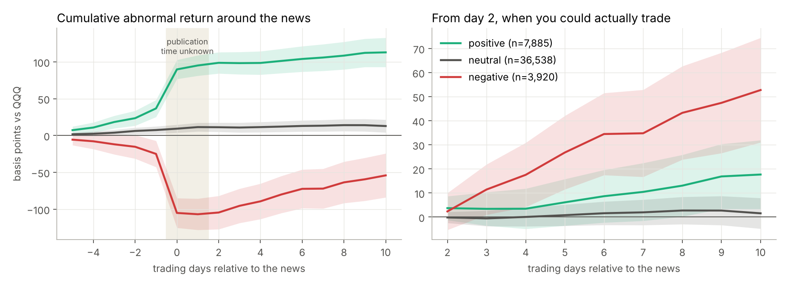
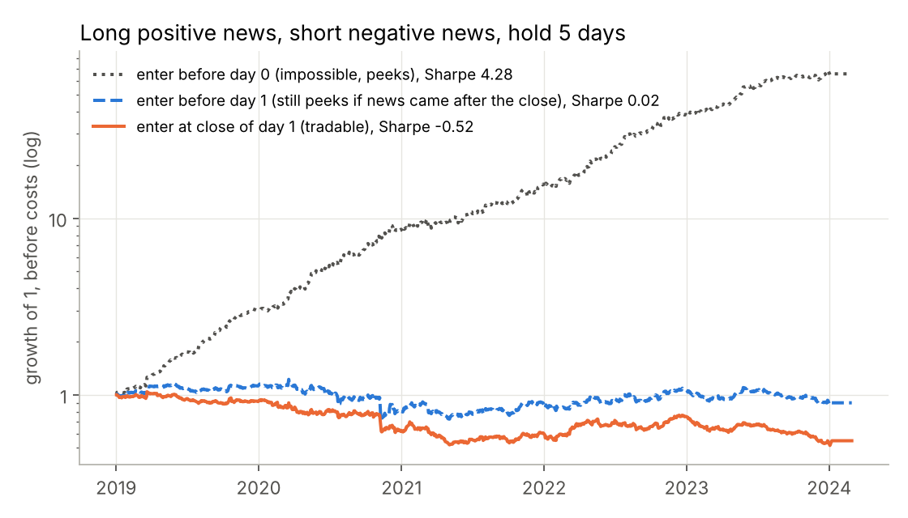

# Financial news sentiment: from transformers to an honest event study

[](https://github.com/adrienliao/financial-news-nlp/actions/workflows/tests.yml)


Two questions, in that order:

1. **Which model reads financial headlines best?** A TF-IDF baseline, FinBERT out of the box, and two transformers fine-tuned with a hand written PyTorch loop.
2. **Does headline sentiment predict stock returns?** 54,845 headlines on Nasdaq 100 stocks (2019 to 2023), scored by the fine-tuned model, lined up with prices while respecting when the news could actually have been known.

Short answer: fine-tuning beats domain pretraining, and the market moves on the news before you can trade it. After that, bad news tends to partially *reverse*.

## Part 1: sentiment classification

Data: [twitter-financial-news-sentiment](https://huggingface.co/datasets/zeroshot/twitter-financial-news-sentiment), 9,543 training and 2,388 test headlines labelled bearish (15%), bullish (20%) or neutral (65%). Nothing is tuned on the test set.

| Model | Accuracy | Macro F1 | Training time (CPU) |
| --- | --- | --- | --- |
| TF-IDF (words + characters) + logistic regression | 83.2% | 0.772 | 12 s |
| FinBERT, no fine-tuning | 72.6% | 0.669 | none |
| **DistilRoBERTa, fine-tuned** | **88.2%** | **0.849** | 17 min |
| FinBERT, fine-tuned | 87.3% | 0.828 | 32 min |

* **FinBERT used as is loses to logistic regression.** It was trained on sentences from financial reports, and short news headlines are a different domain. Pretraining on finance text does not replace training on your own labels.
* **Once fine-tuned, a smaller general model slightly beats the finance specific one**, in half the time.
* Macro F1 matters more than accuracy here: always answering "neutral" already gives 65% accuracy.

Fine-tuning recipe: AdamW, learning rate 3e-5 with 6% linear warmup then linear decay, 2 epochs, batch 32, gradient clipping at 1, max 64 tokens. The fine-tuned FinBERT was the one saved and used for Part 2 (0.9 points of accuracy behind DistilRoBERTa).

## Part 2: does sentiment move prices?

Each headline gets a score P(bullish) minus P(bearish). Scores above 0.5 count as positive news, below -0.5 as negative. Returns are measured against QQQ.

**The timing trap.** Headlines only carry a date, not a time. A story dated D may have come out after the close, so day 0 is the first trading day on or after D, and the earliest honest trade is at the **close of day 1**. Anything earned on day 0 or day 1 is out of reach.



| News | Abnormal return, day 0 to 1 | Abnormal return, day 2 to 10 (95% CI) | Events |
| --- | --- | --- | --- |
| Positive | +0.58% | +0.18% (+0.03%, +0.32%) | 7,880 |
| Neutral | +0.04% | +0.02% (-0.05%, +0.08%) | 36,530 |
| Negative | -0.81% | **+0.53% (+0.31%, +0.74%)** | 3,920 |

* **The reaction is almost entirely on day 0.** Part of it even starts before: many headlines like "Why X stock jumped today" *describe* a move rather than announce news. Sentiment explains returns very well; it predicts them much less.
* **After bad news, prices bounce back.** Stocks with negative headlines recover about half a percent over the next two weeks, which looks like an overreaction to bad news. I found this after looking at the data, so it is a hypothesis to test on another period, not a strategy.
* Positive news shows a small further drift, barely significant.

**What happens if you get the timing wrong:**



Long positive news, short negative news, hold 5 days. Entering before day 0 (which is impossible) gives a Sharpe ratio of 4.3, the kind of number that ends up in a bad paper. Entering at the close of day 1, the only honest version, gives -0.52: the short side gets hit by the rebound after bad news.

## Code

| File | Content |
| --- | --- |
| `newsalpha/sentiment.py` | TF-IDF baseline, FinBERT wrapper, fine-tuning loop in plain PyTorch |
| `newsalpha/events.py` | Date alignment, abnormal returns, event windows, CAR with confidence bands, timing aware long-short |
| `scripts/01_benchmark_sentiment.py` | Trains and evaluates the four classifiers, saves the fine-tuned model |
| `scripts/02_score_headlines.py` | Downloads the headlines and scores them |
| `scripts/03_event_study.py` | Event study and long-short, writes `results/` and the figures |

`data/` holds daily prices and the model scores per headline (date, ticker, three probabilities), not the headline text. The text comes from FNSPID (Dong et al. 2024) and is downloaded by step 2.

Tests cover the date alignment (weekend news goes to Monday), the exact returns picked by event windows, a check that **a big move on day 0 or day 1 is never captured by the tradable strategy**, the short side and the threshold, and the label reordering for FinBERT.

## Run it

```bash
pip install torch --index-url https://download.pytorch.org/whl/cpu
pip install -e ".[dev]"
pytest -q
python scripts/01_benchmark_sentiment.py   # about 50 minutes on CPU, much less on a GPU
python scripts/02_score_headlines.py
python scripts/03_event_study.py
```

## Limits

Only 85 of the 89 stocks have prices (four have been delisted or taken private since), the headlines come from one aggregator (nasdaq.com), and abnormal returns are market adjusted rather than from a factor model. Exact publication times would let the analysis use intraday prices and remove the two day blind spot.

## References

* D. Araci (2019), *FinBERT: financial sentiment analysis with pre-trained language models*
* Z. Dong, X. Fan, Z. Peng (2024), *FNSPID: a comprehensive financial news dataset in time series*
* P. Tetlock (2007), *Giving content to investor sentiment: the role of media in the stock market*
* W. De Bondt, R. Thaler (1985), *Does the stock market overreact?*
